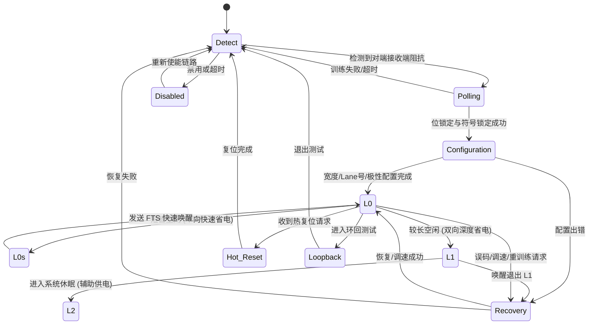

# LTSSM 状态机详解 (Link Training and Status State Machine)

**LTSSM（链路训练与状态机）** 是 PCIe 物理层的大脑，负责管理一条链路从上电探测、参数协商、全速通信、空闲省电到异常恢复的全生命周期。如果把 PCIe 链路比作一条双向高速公路，LTSSM 就是交通调度中心：先确认对面通车了，再对齐车道与限速，空闲时关闭部分照明省电，遇到拥堵或故障时迅速重整车流。

---

## LTSSM 在协议栈中的位置

```text
+---------------------------------------+
|  Transaction Layer (事务层)            |
+---------------------------------------+
|  Data Link Layer (数据链路层)          |
+---------------------------------------+
|  Physical Layer - Logical (物理层逻辑) |
|  +---------------------------------+  |
|  |           LTSSM 状态机           |  | ◀── 控制建链、调速、省电、复位
|  +---------------------------------+  |
+---------------------------------------+
|  Physical Layer - Electrical (电气层)  |
+---------------------------------------+
```

---

## 11 个核心状态与转换关系

LTSSM 共定义了 **11 个主状态**，按功能可分为 4 类：
- **建链启动**：`Detect` → `Polling` → `Configuration` → `L0`
- **正常运行**：`L0`
- **低功耗省电**：`L0s`、`L1`（含 `L1.1`/`L1.2`）、`L2`
- **维护与异常**：`Recovery`、`Hot Reset`、`Loopback`、`Disabled`



---

## 各状态详解

### 1. Detect（检测）
- **职责**：判断对端是否插有 PCIe 设备，无需通信即可探测。
- **原理**：在 `Detect.Quiet` 短暂静默后进入 `Detect.Active`，发送端在差分线上施加电压脉冲，检测对端 50 Ω 端接阻抗的 RC 充电时间变化。一旦检测到接收端存在，立即进入 `Polling`。

### 2. Polling（轮询）
- **职责**：建立**位锁定（Bit Lock）**和**符号锁定（Symbol Lock）**，并交换初步速率能力。
- **子状态**：
  - `Polling.Active`：持续发送 **TS1** 训练序列，让对端 CDR 锁定比特边界和 `K28.5`/Sync Header 边界。
  - `Polling.Configuration`：收到足够多有效 TS1 后切换发送 **TS2**，确认双方准备就绪。
  - `Polling.Compliance`：合规性测试模式（仅用于实验室仪器测试）。

### 3. Configuration（配置）
- **职责**：协商最终的**链路宽度（Link Width）**、**Lane 编号**，并自动处理布线问题。
- **关键动作**：
  - 取双方支持宽度的交集（如 x16 对 x8 → 协商为 x8）。
  - 自动检测并纠正 **Lane 反转（Lane Reversal）** 与 **差分极性反转（Polarity Inversion）**。
  - 完成多 Lane **去偏斜（Deskew）**，并协商是否启用扰码（Scrambling）。

### 4. L0（正常运行）
- **职责**：链路完全激活，正常传输 TLP 和 DLLP。
- **说明**：初始进入 `L0` 时通常运行在 **Gen 1（2.5 GT/s）**；若双方均支持更高速率，会立即通过 `Recovery` 状态切换至 Gen 2/3/4/5/6。

### 5. L0s / L1 / L2（低功耗状态）

| 状态 | 唤醒延迟 | 节电幅度 | 行为特征 |
| :--- | :--- | :--- | :--- |
| **L0s** | < 1 μs | ~20%–30% | **单向独立**进入电气空闲；PLL 保持锁定，退出时发 FTS 即可快速恢复 |
| **L1** | 2–4 μs | ~50%–70% | **双向同步**进入；关闭内部 PLL，退出需经过 `Recovery` 重锁定 |
| **L1.1 / L1.2** | 10–100 μs | ~70%–90% | L1 子状态：通过 `CLKREQ#` 关闭 100 MHz 参考时钟（L1.2 还会关闭共模电压） |
| **L2** | > 10 ms | 仅辅助供电 | 对应系统睡眠（S3/S4），主电源关闭，唤醒必须从 `Detect` 重新训练 |

### 6. Recovery（恢复）
- **职责**：在不复位整个设备的前提下，重新对齐时钟、修复瞬时误码，或**动态切换链路速度/宽度**。
- **子状态**：
  - `Recovery.RcvrLock`：重新锁定 CDR 与符号边界。
  - `Recovery.Equalization`（Gen 3+）：执行发送端和接收端链路均衡调优。
  - `Recovery.Speed`：双方同步切换 PLL 到目标速率。
  - `Recovery.RcvrCfg` / `Recovery.Idle`：确认参数并回到 `L0`。

### 7. Hot Reset / Loopback / Disabled
- **Hot Reset（热复位）**：通过带内 TS1 控制位通知对端复位，不断电清除链路层/事务层状态并回到 `Detect`。
- **Loopback（环回）**：将接收到的数据直接环回发送，用于芯片量产测试或误码率（BERT）诊断。
- **Disabled（禁用）**：软件写入 Link Control 寄存器禁用链路，或多次训练失败后的停机状态。

---

## ASPM（主动状态电源管理）权衡

**ASPM（Active State Power Management）** 是硬件自动利用 `L0s` 和 `L1` 省电的机制，无需操作系统频繁干预：

| ASPM 策略 | 延迟影响 | 节能效果 | 适用场景 |
| :--- | :--- | :--- | :--- |
| **关闭（Off）** | 零额外延迟 | 无 | 高性能计算、低延迟 NVMe SSD、实时网卡 |
| **仅 L0s** | 极低（< 1 μs） | 轻度 | 兼顾响应速度与功耗 |
| **L0s + L1 / L1.2** | 中到高（数 μs–100 μs） | 显著 | 笔记本电脑、移动设备、轻载服务器 |

---

## 常用观测与调试命令

```bash
# 1. 查看设备支持的 ASPM 能力及当前开启状态
lspci -vvv -s 01:00.0 | grep -E "LnkCap|LnkCtl|LnkSta"

# 2. 手动触发一次链路重训练（会进入 Recovery 状态，短暂中断链路）
# 向 Link Control (CAP_EXP + 0x10) 写入 Bit 5 (Retrain Link)
sudo setpci -s 01:00.0 CAP_EXP+10.w=0x0020

# 3. 检查是否因信号不稳频繁触发 Recovery（查看 AER 可纠正/不可纠正错误）
lspci -vvv -s 01:00.0 | grep -A6 "Advanced Error Reporting"
```

---

## 关联与引申概念

- **链路训练全流程**：从上电到高速 L0 的分步交互与 TS1/TS2 字段解析，详见 [链路训练过程](link-training.md)。
- **链路均衡（Link Equalization）**：Gen 3+ 在 `Recovery` 阶段调优 TX/RX 滤波器的过程，详见 [链路均衡](link-equalization.md)。
- **链路宽度与反转**：`Configuration` 阶段如何协商 x1–x16 宽度及纠正 Lane/极性反转，详见 [链路宽度](link-width.md)。
- **Retimer**：链路上插入重定时器时，如何透明参与 LTSSM 训练，详见 [Retimer 详解](retimer.md)。
- **AER（高级错误报告）**：记录物理层 `Receiver Error`、`Bad TLP` 等异常的寄存器机制。
